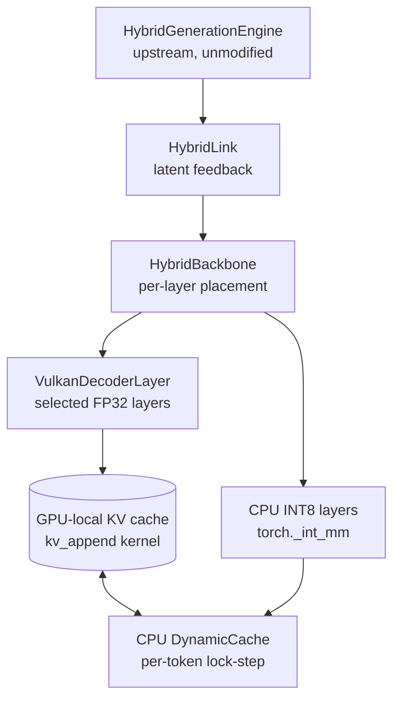

# HybridAgent — PyTorch CPU INT8 / Vulkan Heterogeneous Inference

> **Experimental, reproducible research implementation** — an initial
> technical release of a working heterogeneous inference system, not a
> universally optimized production runtime. All numbers below are for
> the exact tested hardware only.

HybridAgent (Together AI, Stanford, UIUC, Meta — [arXiv:2610.18861](https://arxiv.org/abs/2610.18861),
[upstream](https://github.com/togethercomputer/HybridAgent)) is an LLM
agent that reasons *latently* — in continuous hidden space, via a
lightweight **HybridLink** that maps last-layer hidden states back into
input-embedding space — and only renders readable pseudo-text for
inspection. This repository keeps that research design untouched and
investigates a systems question: **can a consumer CPU + AMD GPU execute
it efficiently without ROCm or a replacement inference engine?**

This implementation changes only *where* the Qwen3 backbone's transformer
layers execute. Everything else — `HybridGenerationEngine`, `HybridLink`,
sampling, tool handling — is upstream code, vendored in
[`third_party/HybridAgent/`](third_party/HybridAgent/) (MIT).

## Features

- **Native PyTorch CPU INT8** — per-channel INT8 weights, per-row
  activation quantization, int32 GEMV via `torch._int_mm` (no FP32
  dequantization per forward).
- **Custom Vulkan compute** — a raw-Vulkan backend (`tvkvk.so`, built
  from `backend/torch_vulkan_ext/csrc/vk_backend.cpp`) with no ROCm
  dependency; FP32 decoder layers dispatched to an AMD RX 6600 XT.
- **Configurable placement** — contiguous first-N layers on Vulkan
  (`HYBRID_GPU_LAYERS`), the rest on CPU INT8.
- **GPU-local KV cache** — K/V history resident in Vulkan buffers
  (`gpu_kv_cache.py`), appended with the `kv_append` kernel and kept in
  lock-step with the CPU `DynamicCache` per token.
- **Safety** — independent-process watchdog (`gpu_watchdog.py`,
  fail-closed) and cross-process Vulkan safety guards.
- **Reproducibility** — canonical harness, regression tests, checkpoint
  hashes, and a release-qualification gate report.

## Architecture



## Quick start

```bash
git clone https://github.com/B-A-M-N/hybridagent-pytorch-vulkan.git
cd hybridagent-pytorch-vulkan
bash scripts/install.sh          # venv, pinned stack, shaders, tvkvk.so
```

Checkpoints are not distributed: obtain the upstream HybridAgent 8B FP32
checkpoint and prepare the INT8 conversion (per-channel symmetric
quantization) under `weights/` — see [docs/installation.md](docs/installation.md)
for hashes and layout.

Run it (CPU-only smoke example, also at `examples/cpu_only_smoke.py`):

```bash
HYBRID_GPU_LAYERS=0 HYBRID_STEPS=5 .venv/bin/python -u test_100_latent_full.py
```

Heterogeneous example (2 Vulkan layers) and the full 100-step benchmark:

```bash
HYBRID_GPU_LAYERS=2 HYBRID_STEPS=100 PROFILE_LATENT=1 \
  .venv/bin/python -u test_100_latent_full.py
```

Tests: `./scripts/run_tests.sh`

## Performance (qualified, 100 latent steps)

| Config | Warm median | Throughput |
|---|---|---|
| CPU-only (0 GPU) | ~403 ms/step | ~2.5 steps/s |
| Heterogeneous (2 GPU) | ~436 ms/step | ~2.3 steps/s |

**CPU-only is faster for this measured single-token latent workload.**
Vulkan offloading is functional and valuable for heterogeneous-execution
research, but it is not universally faster — after the `_int_mm`
optimization, CPU INT8 layers (~11 ms) undercut Vulkan layers
(~18–32 ms). See [BENCHMARKS.md](BENCHMARKS.md) for methodology,
raw results, and historical comparisons (separately labelled).

## Supported environment

- **Tested:** Ryzen 9 5900X, RX 6600 XT 8GB, RADV Vulkan 1.4,
  Python 3.11, PyTorch 2.12.0+cpu, transformers 5.13.0.
- **Not tested:** any other GPU/CPU, NVIDIA/Intel/Apple, ROCm, GGUF.
  No broader compatibility is claimed.

## Documentation

- [Architecture](docs/architecture.md) · [Installation](docs/installation.md) ·
  [Usage](docs/usage.md) · [Limitations](docs/limitations.md)
- [Benchmarks](BENCHMARKS.md) · [Release qualification](RELEASE_QUALIFICATION.md)

## Known limitations

Experimental status; CPU-only fastest (above); Q4 GEMV disabled and
unqualified; `_int_mm` ~1% approximate vs FP32; 20-GPU-layer VRAM hang;
18–20 GB harness RAM. Details: [docs/limitations.md](docs/limitations.md).

## Acknowledgments & licensing

Original HybridAgent research and code: Zou et al. (Together AI,
Stanford, UIUC, Meta), vendored MIT in `third_party/HybridAgent/`
(provenance: snapshot, upstream commit unknown). `third_party/torch-vulkan/`
(MIT, snapshot) is legacy and unused by the canonical path. This
repository's heterogeneous backbone, Vulkan backend, GPU KV cache, and
INT8 CPU path are the engineering contributions. Experimental research
use only.
